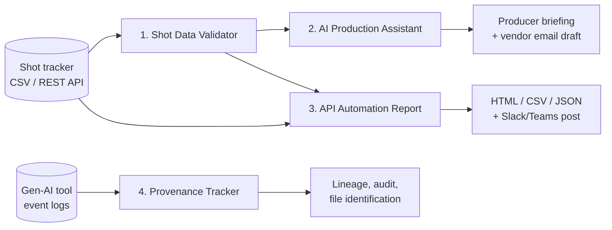
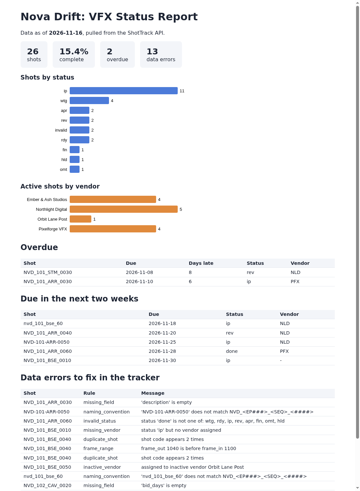
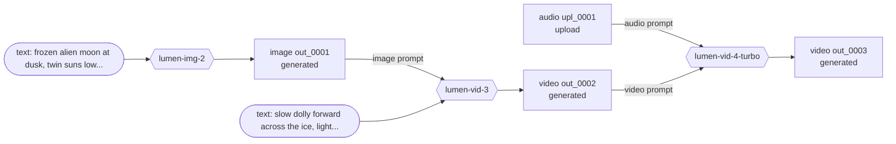

# VFX Pipeline Automation & AI Workflows: Python Portfolio

[](https://github.com/Smithvs1/vfx-pipeline-automation-portfolio/actions/workflows/ci.yml)


These tools come from my work in VFX and media production. Each one automates a task I've done by hand:
checking shot data, writing status updates, pulling reports from tracking systems, and tracking where
AI-generated assets came from.

> **Projects 1–4 use only fictional data.** *Nova Drift* and *Harbor Lights* are made-up shows, and the
> vendors, artists and the generative-AI tool "Lumen" are invented. No employer code, production data or credentials are included. Project 5 is code from my own product, SignedIt.

| # | Project | What it shows | Run it |
|---|---|---|---|
| 1 | [**Shot Data Validator**](shot_validator/) | Rule-based checks on shot data: naming conventions, invalid statuses, missing or inactive vendors, duplicate shots, frame ranges, overdue dates, vendor capacity | `python -m shot_validator sample_data/shots.csv --vendors sample_data/vendors.csv` |
| 2 | [**AI Production Assistant**](production_assistant/) | LLM workflow: structured data → JSON summary → prompt → daily producer briefing, with a check that catches made-up shot codes. Works with OpenAI, Anthropic or an offline mode | `python -m production_assistant sample_data/shots.csv --vendors sample_data/vendors.csv` |
| 3 | [**API Automation Report**](api_report/) | REST client with auth, paging and retry/backoff (429/503) → transform → HTML/CSV/JSON report + Slack/Teams webhook. Ships with a mock tracker API | `python -m api_report --mock --flaky` |
| 4 | [**AI Asset Provenance Tracker**](provenance_tracker/) | Lineage for generative-AI assets: text, image, audio and video prompts → generations → outputs → downloads. Uses SQLite, recursive lineage queries, file lookup by content hash, impact analysis and a tamper-evident hash-chained event log | `python -m provenance_tracker ingest sample_data/genai_events.jsonl` |
| 5 | [**SignedIt: live AI product**](signedit/) | Real production code from [signedit.app](https://signedit.app), my AI interview-prep platform: Claude structured output, Stripe, Supabase, and a daily GitHub Actions pipeline that writes, illustrates and publishes LinkedIn/Instagram content and refreshes its own OAuth tokens | see [signedit/](signedit/) |

## Quick start

```bash
git clone https://github.com/Smithvs1/vfx-pipeline-automation-portfolio.git
cd vfx-pipeline-automation-portfolio
python -m venv .venv && source .venv/bin/activate      # Windows: .venv\Scripts\activate
pip install -r requirements.txt -r requirements-dev.txt
./demo.sh            # runs all four projects against the sample data
pytest               # 35 tests
```

None of the projects need an API key. Project 2 can use a real LLM if you set `OPENAI_API_KEY` or `ANTHROPIC_API_KEY`.

## How the projects fit together



## Example output (committed so you can see it without running anything)

- [Validation report](docs/examples/validation_report.md): Project 1
- [Producer briefing](docs/examples/briefing_offline.md): Project 2
- [HTML status report](docs/examples/api_report/) + screenshot below: Project 3
- [Provenance CLI session](docs/examples/provenance_session.txt) and a [provenance manifest](docs/examples/provenance_manifest_out_0003.json): Project 4



Lineage of one AI-generated previs shot (Project 4, `lineage out_0003 --format mermaid`): a text prompt makes
an image, the image becomes a video, and the video is combined with an uploaded temp voice-over:



## Skills demonstrated

- **Python**: dataclasses, type hints, argparse CLIs, a simple rule registry, generators, `sqlite3` with recursive CTEs, `http.server`, `hashlib`
- **AI / LLM integration**: prompt templates kept in their own files, structured JSON input for the model, more than one provider, a fallback that runs offline, and output checks against the source data
- **APIs**: `requests` sessions, bearer auth, paging, retries with backoff and `Retry-After`, webhooks
- **Data quality and lineage**: validation rules, safe re-imports (duplicates skipped), each event saved all-or-nothing, tamper-evident audit log
- **Engineering practice**: pytest suite, ruff linting, GitHub Actions CI, reproducible sample-data generator

## About me

**Star Victoria**: VFX Coordinator / Production Manager and Pipeline & Automation Specialist. Los Angeles.

- **Now:** GenAI / VFX MosAIc Project Manager, Amazon MGM Studios (via Populous). I onboard shows and users to generative-AI
  tools (Runway, Magnific, Krea, Topaz, ElevenLabs, ComfyUI...), manage credit usage, and automate intake and
  reporting with Python, APIs and webhooks.
- **VFX coordination:** 1,700+ shots on *Michael* (Universal / Lionsgate) with ILM, Rising Sun Pictures and Cinesite.
  1,800+ on *The Gorge* (Skydance / Apple), 790+ on *Citadel* S1 (AGBO / Amazon), 2,100+ on *Naomi* S1 (Warner Bros.).
  Also *Carry On* (Amblin / Netflix), and previs on *The Falcon and the Winter Soldier* (The Third Floor) and *The Suicide Squad* (Proof).
- **Automation:** Python with the ShotGrid (Flow) API for validation and batch updates, AppleScript, Automator and
  Hazel for delivery prep and file cleanup, and certified FileMaker Pro production databases.
- **Builder:** founder of [SignedIt](https://signedit.app) (Project 5). I also built the membership and payments backend for
  Mission: Brave Heart (Express, Stripe subscriptions, Supabase).
- Voting member of the Television Academy (VFX Peer Group) and the Producers Guild of America. Former 1st AD. MFA, USC School of Cinematic Arts.

Projects 1–4 take problems I've dealt with in production (messy tracker data, vendor follow-ups, status
reporting, accountability for AI-generated assets) and turn them into tested, reusable tools.

Contact: starvictoriafilms@gmail.com
