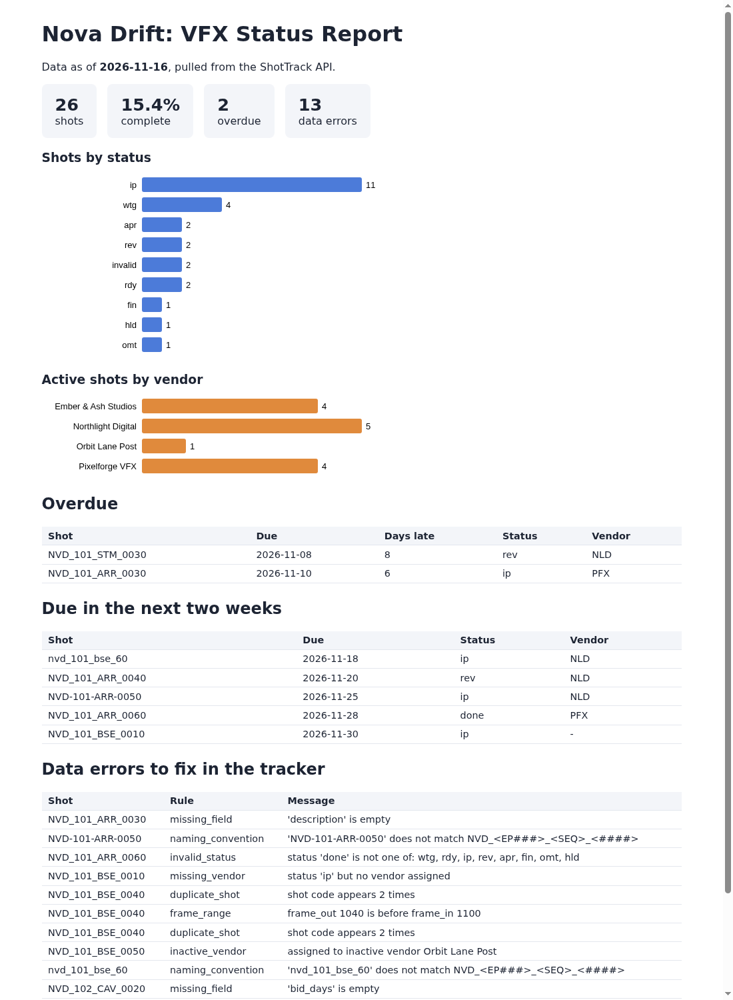

# Project 3: API Automation Report

**Problem:** Status reports get built by exporting from the tracker (ShotGrid, ftrack, an internal tool),
pasting into a spreadsheet, making charts, and emailing the result. This happens every day, by hand.

**Solution:** A scheduled job that pulls from the tracker's REST API, runs the Project 1 checks, and
publishes an HTML dashboard, CSV and JSON. It can also post a summary to Slack or Teams.



## Run it

```bash
# One command: starts the bundled mock tracker API, injects 429/503 errors, and builds the report
python -m api_report --mock --flaky --out reports/

# Run the mock server on its own and point the client at it
python -m api_report.mock_server --port 8765 &
SHOTTRACK_URL=http://127.0.0.1:8765 SHOTTRACK_TOKEN=demo-token python -m api_report --out reports/

# Post a summary to a Slack/Teams incoming webhook
python -m api_report --mock --webhook-url "$REPORT_WEBHOOK_URL"
```

## What it demonstrates

- `client.py`: a `requests.Session` with bearer auth, automatic paging (`next_page`), timeouts, and
  urllib3 `Retry` with exponential backoff that respects `Retry-After` on 429/5xx. Clear errors for 401s.
- `mock_server.py`: a dependency-free fake tracker API (`http.server`) with auth, paging, filters
  (`?status=ip&vendor_id=PFX`) and optional fault injection. Tests run against a real HTTP server, not mocks.
- `pipeline.py`: extract → transform (reuses Projects 1 and 2) → publish. The HTML report is a single
  self-contained file with inline SVG charts, so it can be emailed or hosted anywhere.
- Credentials come from environment variables only (`SHOTTRACK_TOKEN`, `REPORT_WEBHOOK_URL`) and are
  never written to disk or logs.

To run it daily, schedule `python -m api_report` with cron, Windows Task Scheduler, or a GitHub Actions
`schedule:` trigger.
