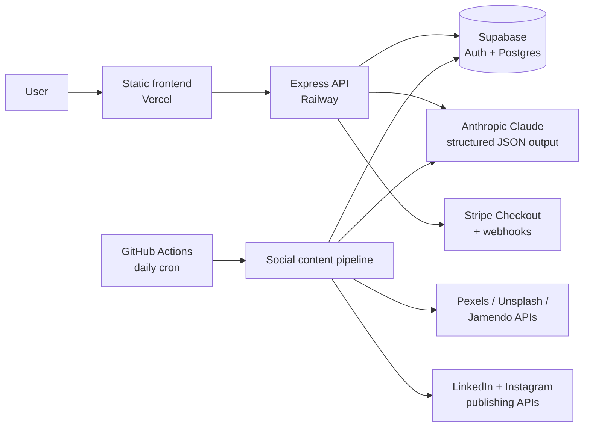

# Project 5: SignedIt, a live AI product I built and run

**[signedit.app](https://signedit.app)** is an AI-powered interview-prep platform. A user uploads a résumé and a
job description. Claude returns a structured prep guide: requirements mapped to the candidate's experience,
skill gaps, STAR-method answer hints that name the candidate's real projects, and questions to ask the
interviewer. I designed the product and built and operate the automation around it.

Unlike Projects 1–4, this is **real production code** from my own product. Credentials are only read from
environment variables or GitHub Secrets, and none are included here. The core product prompts, backend and
customer data stay private.

## Architecture

## What's automated

**1. AI prep-guide generation (backend, private)**
- Claude is asked for a strict JSON schema, so the frontend shows it as structured sections instead of free text.
- Budget-aware model choice with automatic fallback to the next model if one isn't available.
  Every call's usage is logged to a metrics table.
- Stripe Checkout and webhooks handle one-time and monthly plans. Guides on the one-time plan expire after 30 days.

**2. [Daily social media pipeline](social-automation/)** (code included)

[`scripts/generate-daily-content.js`](social-automation/scripts/generate-daily-content.js) runs every morning
from GitHub Actions ([workflow](social-automation/workflow/daily-content.yml)), with no one involved:

1. Picks today's topic from a 90-day topic bank and a weekly tone schedule, both stored in Supabase.
2. Generates a Reel script, a static post and a 5-slide carousel with Claude, falling back to another model if needed.
3. Gets matching stock media, alternating Pexels and Unsplash by week. It skips any image used in the last
   90 days and uses FFmpeg to add royalty-free music (Jamendo) to Reel videos.
4. Publishes to a LinkedIn company page and an Instagram business account (single image, carousel and Reel).
   It polls Instagram until media processing finishes.
5. **Refreshes its own OAuth tokens:** Instagram and LinkedIn tokens are saved in Supabase and renewed
   before they expire, so the daily job doesn't break when a token runs out.
6. Saves every generated post, its media and its publish status to Postgres for tracking. A `dry_run`
   switch generates and saves content without posting.

Database schema: [`supabase/schema.sql`](social-automation/supabase/schema.sql).

**Skills shown:** Node.js, REST/OAuth integrations (LinkedIn, Meta Graph, Pexels, Unsplash, Jamendo),
LLM prompt pipelines, Postgres/Supabase, FFmpeg, GitHub Actions scheduling, secret management.

## Note

The workflow file lives in `social-automation/workflow/` and not in `.github/workflows/`, so it doesn't run
from this portfolio repo. The topic bank and prompt templates are product content and aren't published.
